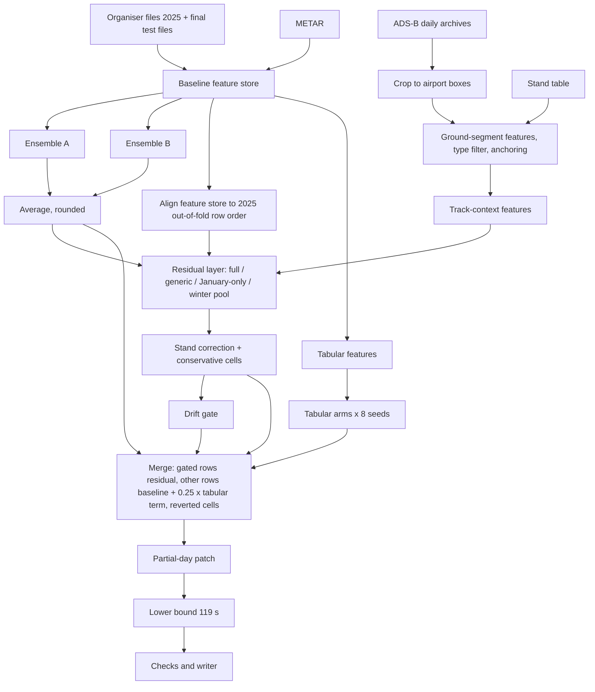

# Taxi-out time prediction for ten European airports (PRC Data Challenge 2026)

Code and method description of team `upstanding-firefly` for the PRC Data Challenge 2026 (OpenSky Network and EUROCONTROL Performance Review Commission). The repository contains the scripts that produced our final-phase predictions, the validation design behind every design choice, and a list of known limitations.

## 1. Problem and data

**Task.** Predict the taxi-out time (`TAXITIME_SEC_mvt`, seconds from off-block to take-off) of departures at ten airports: EDDF, EDDM, EGLL, EHAM, LEBL, LEMD, LFPG, LIRF, LSZH, LTFM. The final phase is one prediction file for January, February, June and July 2026 (670,790 departures). The metric is RMSE.

**Training data.** The organisers' monthly files for 2025 (4,167,797 movements, of which 2,085,047 are departures).

**Inputs.** No data are redistributed here, except the airport geometry file `pipeline/data/airports.json` (ODbL, see section 9).

| Input | Source | Used for |
|---|---|---|
| Training files `training_2025-MM-01_*.parquet` (12), `final_ranking.parquet`, `final_submitting.parquet` | Challenge data, access as granted by the organisers | Everything |
| METAR for the ten airports, 2025-01-01 to 2026-07-31 | Iowa Environmental Mesonet (IEM) ASOS/METAR download service, one CSV per airport in `ext/metar/<ICAO>.csv` | Weather features of the baseline. Request and file format: see "Download details" below |
| ADS-B daily archives (`planes-readsb-prod-0` releases; `staging-0` on 20 days that have no `prod-0` release) | ADSB.lol `globe_history_2025` and `globe_history_2026` releases on GitHub; index of all volumes in `pipeline/data/adsb_manifest.json` | Ground-movement features of the residual layer. Days: 2025-01, 2025-06-11..30, 2025-07, 2025-11, 2025-12-01..30; 2025-02 (forward validation only); 2025-08 (winter-pool evaluation in `residual_cv.py` only); 2026-01, 2026-02, 2026-06, 2026-07 and the boundary days 2026-03-01 and 2026-05-31 |
| Stand and runway coordinates | Merge of OpenStreetMap aeroway data and X-Plane Scenery Gateway `apt.dat` files by `pipeline/data/stand_merge.py`, stored as `ext/xplane-apt/stand_coords_merged.parquet` and `xplane_runways.csv`; `apt.dat` files from `pipeline/data/fetch_xplane_apt.sh` | Stand-to-runway distances, stand matching; the tabular features also read the `apt.dat` taxiway network |
| Airport boxes, runways and stands | `pipeline/data/airports.json`, derived from OpenStreetMap | ADS-B cropping and features |
| EUROCONTROL "Taxi-Out Additional Time" monthly data | EUROCONTROL performance data | Evaluated only, not used for predictions (appendix B) |

**Download details.**
- **METAR.** We downloaded the ten files on 2026-09-06 from the IEM ASOS download service and did not keep the request URL. The files have the columns `station,valid,tmpf,dwpf,relh,drct,sknt,gust,vsby,p01i,skyc1,skyl1,wxcodes,metar`, times in UTC, `M` for missing values, and both routine and special or corrected reports (27,605 to 28,110 reports per airport, from 2025-01-01 00:00 to 2026-07-31 23:50 UTC). According to the documentation of the service (`report_type` 3 = routine, 4 = specials), the following request, one per ICAO code saved as `ext/metar/<ICAO>.csv`, returns files with these properties; we have not re-run it, and the archive can change after our download date:
  ```
  https://mesonet.agron.iastate.edu/cgi-bin/request/asos.py?station=<ICAO>&data=tmpf&data=dwpf&data=relh&data=drct&data=sknt&data=gust&data=vsby&data=p01i&data=skyc1&data=skyl1&data=wxcodes&data=metar&year1=2025&month1=1&day1=1&year2=2026&month2=8&day2=1&tz=Etc/UTC&format=onlycomma&latlon=no&elev=no&missing=M&report_type=3&report_type=4
  ```
  The baseline reads the columns `station`, `valid`, `tmpf`, `sknt`, `vsby` and `wxcodes`.
- **ADS-B.** `pipeline/data/adsb_manifest.json` lists the 655 release volumes of the 323 days we cropped (1,020,626,606,592 bytes in total): date, file name, URL, size, the SHA-256 digest published by GitHub (`digest`; null for the 113 volumes of 2025 whose releases carry none) and the SHA-256 of the file we downloaded (`sha256`). For each day the volumes are those recorded by our crop logs; for 2026-07-26 to 2026-07-31 the crop logs do not name the volumes (these days were cropped from a stream), and the index lists all volumes our downloader fetched for those days. To download: copy `pipeline/data/download_adsb.py` and `adsb_manifest.json` into an empty directory, rename the index to `manifest.json`, set its `root` to the absolute path of that directory (the script asserts this) and run `python download_adsb.py` there; it needs free disk space of 100 GiB plus the remaining download size. For a subset, delete entries from `assets` and set `total_bytes` to the sum of the remaining sizes (also asserted). Then crop with `crop_ready_days.py --src <that directory>` (section 4.3, step 1).
- **Stand and runway tables.** `bash pipeline/data/fetch_xplane_apt.sh <dir>` downloads the scenery packs we used (pinned Gateway scenery IDs; the SHA-256 of our `apt.dat` files is listed in its header) and writes `<dir>/<ICAO>/apt.dat`. The OpenStreetMap input is one Overpass API JSON file per airport, `ext/osm/<ICAO>.json`; ours were downloaded on 2026-09-06 (OSM base timestamp 2026-09-06), and the SHA-256 of each is recorded as `source_sha256` in `pipeline/data/airports.json`. We did not keep the query text. Our files contain the nodes and ways tagged `aeroway` = `runway`, `taxiway`, `parking_position` or `gate` inside the airport area, followed by the untagged nodes of those ways; a query of the following form returns files with this content (the `date` setting requests the OSM state of our download day):
  ```
  [out:json][date:"2026-09-06T12:00:00Z"];area["icao"="<ICAO>"]->.a;(node["aeroway"~"^(runway|taxiway|parking_position|gate)$"](area.a);way["aeroway"~"^(runway|taxiway|parking_position|gate)$"](area.a););out body;>;out skel qt;
  ```
  Then `python pipeline/data/stand_merge.py --xplane-dir <dir> --osm-dir ext/osm --raw <raw dir>` writes `stand_coords_merged.parquet` and `xplane_runways.csv` into `<dir>` (the drivers expect `<dir>` = `final/ext/xplane-apt/`). Our table was built once, in September 2026, with the twelve 2025 training files and the ranking file of the earlier phase in `<raw dir>`, and was used unchanged in the final phase.

**Data notes.**
- Flight-level inputs for the test months come only from the organisers' final files. In `final_ranking.parquet` the times of rows released earlier carry an integer jitter of up to ±12 s; the organisers stated that this is intentional. We build all test-side features from the final files as given and do not try to undo the jitter.
- The ADS-B archive of 2026-06-06 has no positions between 00:00 and 09:59 UTC at any of the ten airports (handled by strategy 23).

## 2. Method overview

The prediction is a gradient-boosting baseline, plus an ADS-B residual correction on flights whose ground movement is visible, plus a shrunken tabular correction on the other flights. Evidence numbers below come only from 2025 training data: cross-validation (CV), forward validation, or rules written down before the computation. "pp" means percentage points of the baseline's sum of squared errors on non-extreme rows (positive = better); "±" is a day-block or day-paired standard error.

### 2.1 Data and features

| # | Strategy | What | Evidence |
|---|---|---|---|
| 1 | Training and prediction range | Train on all 2025 departures; predict January, February, June and July 2026 | Task definition |
| 2 | Organiser files as given | Test-side flight records come only from the final release files; the ±12 s jitter is kept. External data (METAR, ADS-B, stand and runway coordinates) are listed in section 1 | Organisers stated the jitter is intentional |
| 3 | Per-month statistics | Ordering- and count-type features (for example overtaking counts) are computed separately for each calendar month, in training and test alike | Same definition on both sides |
| 4 | Schedule and delay features | Take-off time minus scheduled time, take-off time minus the network-manager actual off-block time, plus aircraft type, airport, stand, runway, month, weather | Base features |
| 5 | Same-day traffic features | Departure and arrival counts around the take-off time, runway gaps, overtaking counts, stand occupancy, local delay regime; computed from the unlabelled test-period records themselves | Base features |

### 2.2 Baseline

| # | Strategy | What | Evidence |
|---|---|---|---|
| 6 | Off-block offset formulation | For flights with a network-manager actual off-block time, the prediction is (take-off − that off-block time) plus a learned offset; other flights get a direct taxi-out model | Base design |
| 7 | Ensemble A | Five members: `sr_g5_delta` (LightGBM), `cat_delta` (CatBoost), `anc_iobt` (LightGBM on an offset to IOBT; rows without IOBT use a direct taxi-out model), `apt_delta` (one LightGBM per airport), `lirf2_over` (LIRF late-departure two-stage model that overrides its candidate rows); in every member the LIRF artefact-class rows come from a dedicated sub-model. Weights 1/6, 2/6, 1/6, 1/6, 1/6 from Caruana hill climbing with replacement (6 picks) on two folds; one seed per member | Two-fold CV (January and July 2025 held out) |
| 8 | Ensemble B | Four members: `srp_g5_delta` (LightGBM with one stacked extra feature: the leave-one-month-out probability, from a separate classifier, that the block time equals the scheduled time within 60 s; 3 seeds), `cat_delta` (CatBoost, averaged over 8 seeds), `anc_iobt` and `apt_delta` shared with ensemble A. Weights 3/7, 2/7, 1/7, 1/7 | CatBoost 8 vs 3 seeds: pooled two-fold RMSE −0.055 s, ΔMSE −34.1 ± 10.8 (z −3.15), both folds better |
| 9 | Equal-weight average | Baseline = round-half-even of the mean of the two ensembles | Pooled RMSE −1.14 s against ensemble A alone, 4 of 5 day folds better |

### 2.3 ADS-B ground-trajectory residual layer

| # | Strategy | What | Evidence |
|---|---|---|---|
| 10 | Ground-trajectory cropping | Download ADS-B daily archives and keep only ground and low-altitude points inside the ten airport boxes | Data preparation |
| 11 | Residual model | Match each departure to an ADS-B take-off event and its ground segment; a LightGBM model predicts the baseline residual from ground-movement features. Applied only to flights with a matched segment ("gated" rows) | Date-grouped 5-fold CV, first version: non-extreme SSE −15.9 % |
| 12 | Training set and airline encoding | 62 training days (January and July 2025) with ADS-B; adds an airport×airline and airline encoding of how often delayed departures (> 20 min) have a label equal to take-off − scheduled time (± 60 s) | The encoding: +0.47 ± 0.63 pp, below 2 SE; kept, see limitations |
| 13 | Coverage threshold | An airport uses the full model (with airport identifiers, coordinates and grid-cell and stand target encodings) when at least 15 % of its non-extreme training departures are gated, otherwise a generic model without airport identifiers. In January, airports that reach the threshold in January 2025 and are not covered by the winter pool (strategy 18) use a January-only full model | +0.30 ± 0.08 pp, best of 8 pre-listed variants |
| 14 | Corrected stand coordinates | Stand distances use the merged OSM and `apt.dat` stand table with a normalised stand-name match | +0.53 ± 0.16 pp |
| 15 | Aircraft-type filter | Time-based event matching only accepts ADS-B events whose aircraft-type family matches the flight's | +0.49 ± 0.12 pp, 5/5 folds |
| 16 | Track-context features | 17 features describing the trajectory before and around the start of the ground segment (definitions in section 2.7) | +0.88 pp, 5/5 folds; forward check passed |
| 17 | Stand correction table | A per-stand correction of the residual, estimated from out-of-fold residuals (smoothing m = 20), added on gated rows outside the conservative cells | +0.168 pp (CV), +0.166 pp (forward) |
| 18 | Winter pool, segment anchoring, seed averaging | In January and February, gated rows of seven airports (EDDF, EDDM, EGLL, EHAM, LEBL, LSZH, LEMD) use a full model trained on the January 2025 days plus a pool of November and December 2025 departures; the segment start is re-anchored to the last stationary period at the stand; 8 LightGBM seeds averaged | Forward +1.08 pp, 5/5 folds; anchoring with 8 seeds +0.25 ± 0.11 pp |
| 19 | Conservative cells | In EGLL June and July and in all LIRF months, gated rows use the simpler residual variant (same winter pool, anchoring and 8 seeds, but without track-context features and without the stand correction) | No 2025 CV gain in these cells; 2026 coverage pattern differs; written as a rule beforehand |

### 2.4 Tabular blend

| # | Strategy | What | Evidence |
|---|---|---|---|
| 20 | Shrunken tabular term | Two LightGBM arms (with and without five families of extra features: unused record fields, stand geometry, operations state, turnaround chain, local calendar; plus four residual target encodings), each averaged over 8 seeds; `0.25 × (new − base)` is added to the baseline on rows that are not gated and not in the LIRF artefact class | On the rows where it is applied: +0.30 ± 0.07 pp, both folds positive. Averaging 8 seeds per arm instead of 1: +0.28 ± 0.04 pp (CV on all non-extreme rows except LIRF July) |

### 2.5 Drift guard

| # | Strategy | What | Evidence |
|---|---|---|---|
| 21 | Drift gate | A label-free rule written before use: per airport × month, compare the 2026 distributions of the 17 track-context and 19 ADS-B columns on gated rows with the 2025 reference month. A column triggers on PSI ≥ 0.25 or a missing-rate change ≥ 0.10, each also at least 3 times the median of the other cells of that month. A cell falls back to the simpler residual variant of strategy 19 when at least 3 track-context columns trigger and the track-context features shift the cell's mean prediction by at least 3 s and by at least 5 times the shift seen in 2025 CV (where available); EDDF January is also judged separately from the 29th. Applied to EDDF February and July, EDDF 29–31 January, LSZH June and July | Rule fixed before seeing its output; in a null split of each 2025 reference month (days 1–15 against 16–31), 0.79 % of column PSIs reach 0.25 (< 5 %) |
| 22 | Mapping to new months | February uses the winter-pool model of strategy 18; the conservative EGLL July cell extends to EGLL June; the drift gate compares February with January 2025 and June with July 2025 | Rule written beforehand; no validation available |

### 2.6 Finalisation

| # | Strategy | What | Evidence |
|---|---|---|---|
| 23 | Partial-day patch | Gated rows with take-off between 2026-06-06 00:00 and 2026-06-08 00:00 UTC (that is, on 6 and 7 June) whose window from 18 hours before the ground-segment start to take-off touches a missing hour of their airport (2,529 rows) take the value of the same row in the fallback file, a prediction without ADS-B in June | Rule written beforehand, with a coverage self-check |
| 24 | Lower bound 119 s | Predictions below 119 s are raised to 119 s (the 0.1 % quantile of 2025 departure labels) | 2025 out-of-fold check: 119 best among the pre-listed candidates (30 to 119 s; 119 is the largest) |
| 25 | Submission checks | Hard checks: row count and ID set equal to the template, no duplicates, no missing or non-finite values, column names, order, types and row order as the template, values equal after reading the file back; the value distribution is only reported | Process check |

### 2.7 Definitions of the 17 track-context features

All are computed from the ADS-B points of the matched aircraft at the departure airport within 18 hours before the last ground point; times are expressed as seconds before take-off. Code: `track_context_rows.py` (`row_track`), columns `tk_*`.

- **Motion (7):** first point of the ground segment with ground speed ≥ 1, ≥ 5 and ≥ 8 kt; first point more than 30 m from the segment start; first reversal (heading opposite to the movement, speed ≤ 12 kt); a turn of more than 135° within 10 minutes of the segment start; share of steps where reported track and movement bearing agree within 45°.
- **Stand (4):** start of an extended segment that bridges stationary gaps (< 50 m, < 1 kt, < 6 h, at most 12 h); start of motion after at least 60 s stationary at that start; time of leaving the assigned stand (last stationary point within 100 m of the stand); distance from the extended segment's first point to the stand.
- **Gap and arrival (6):** duration and distance of the data gap (≥ 600 s) that ended the ground segment; the reason the segment ended (gap, 3-hour limit, airborne point, start of data or window); time since the last airborne point; number of movement episodes from standstill after arrival (≥ 30 m, ≥ 300 s still before); time of the earliest such episode.

## 3. Pipeline



### 3.1 Strategy to code

Scripts are listed by repository path; environment variables are set in the drivers.

| # | Files | Parameters |
|---|---|---|
| 1 | `pipeline/baseline/runner/configs/baseline_{3,8}seed.json` | `train_year` 2025, `train_months` 1–12, `test_months` 2026-01/02/06/07, `rank_file` `final_ranking.parquet` |
| 2 | `pipeline/baseline/baseline_models.py` (stage `feat`) | Reads the final files; no de-jitter step |
| 3 | `baseline_models.py`, `features_extended.py` | `FEAT_SPLIT=1` in `env_override` of both configs |
| 4–5 | `features_base.py`, `features_extended.py`, `baseline_models.py` (feature sets `sr`, `srp`) | Feature lists in the code |
| 6 | `baseline_models.py` (`stage_fullens`, member suffix `_delta`) | — |
| 7 | configs, first ensemble block; `baseline_models.py` (`stage_ens`, `stage_fullens`); `runner/run_baseline.py`, `runner/model_runner.py` | weights, `NSEED=1`, `CATSEED=1`; round counts fixed at 1.15 × the mean two-fold early-stopping iteration (`expect_iters`) |
| 8 | configs, second ensemble block; `schedule_match_classifier.py`; `pipeline/drivers/run_baseline_8seed.sh`, `pipeline/baseline/verify_baseline_8seed.py`; evidence `evaluation/catboost_seeds_cv.py` | `PI=1`, `NSEED=3`, `CATSEED=8` (`baseline_8seed.json`; 3 in `baseline_3seed.json`) |
| 9 | `runner/average_ensembles.py`; evidence `evaluation/cv_recheck_design_choices.py` | `np.rint((A + B) / 2)` |
| 10 | `pipeline/data/download_adsb.py`, `crop_day.py`, `crop_ready_days.py`, `airports.json` | `--max-alt 4000` (default) |
| 11 | `pipeline/adsb_residual/build_feats.py`, `train_resid.py` | LightGBM lr 0.03, 31 leaves, 600 rounds; gate = matched segment |
| 12 | `train_resid.py` (`add_art`); `run_stage_chain.sh` (`D25`) | `RESID_EXTRA=art` |
| 13 | `train_resid.py` (`fit_mixed`) | `RESID_FULL_THR=0.15`, `RESID_MONTH=hyb:01` |
| 14 | `build_feats.py --stands`, `train_resid.py` | `RESID_STAND=fix`, `RESID_STAND_DIR=feats_tma` |
| 15 | `build_feats.py --typefilter`, `type_chk.py` | — |
| 16 | `track_context_rows.py rows`, `build_track_context.py main/pool`, `train_resid.py` | `RESID_TK=all` |
| 17 | `residual_context.py evalx` (table), `residual_context.py applysc` (apply); inputs from `residual_cv.py cv` | m = 20 |
| 18 | `build_feats.py --anchor`, `train_resid.py` | `RESID_WINTER=11+12`, `RESID_WINTER_APTS=EDDF,EDDM,EGLL,EHAM,LEBL,LSZH,LEMD`, `--seeds 8` |
| 19 | `residual_context.py merge/applysc --keep` | `KEEP=EGLL-06,EGLL-07,LIRF` |
| 20 | `pipeline/tabular_blend/build_tabular_features.py`, `tabular_cv.py`, `tabular_term.py`; `pipeline/finalize/merge_predictions.py`; evidence `evaluation/tabular_weight_gate.py`, `tabular_weight_gate_production_rows.py` | `--fam a,b,c,d,e`, `--tekeys te_alst,te_strw,te_tyst,te_alde`, `--seeds 0,...,7`, `--w 0.25` |
| 21 | `pipeline/drift_guard/drift_gate.py`; `merge_predictions.py --revert-cells --simple_file` | `PSI_T=0.25`, `MISS_T=0.10`, `REL=3.0`, `MIN_N=200`, `K_T=3`, `S_T=3.0`, `S_REL=5.0` (in `drift_gate.py`) |
| 22 | `train_resid.py`, `drift_gate.py`, drivers | `RESID_WINTER_TEST=01,02`, `KEEP` includes `EGLL-06`, `--ref-map 02:01,06:07`, `--cv-map 02:01,06:07` |
| 23 | `pipeline/finalize/patch_partial_day.py` | `--margin 64800 --until 2026-06-08T00:00`, `--base` = fallback file |
| 24 | `pipeline/finalize/floor_clip.py`; evidence `evaluation/floor_oof_check.py` | `--q 0.001` (gives 119) |
| 25 | `pipeline/finalize/check_submission.py` | — |

The competition-specific post-processing options and the methods we did not adopt are described in the appendices.

## 4. How to reproduce

**Status.** The pipeline scripts are the versions that produced the submitted file; before publication we edited comments and docstrings (translated to English), root paths, file names, and short internal labels in identifiers, environment-variable names, command-line options and subcommands, stage and step names, report keys, intermediate file and directory names and log labels (replaced by descriptive names, consistently in all scripts; our runs used the earlier labels, and the renaming was checked statically to be one-to-one, not by a rerun), and report-only fields; in `baseline_models.py` the default of the ensemble-weight objective `ENS_OBJ` was set to `mean`, the value the runner sets explicitly for the submitted baseline, and a scale constant of the unused `proxy` objective was removed. None of these edits changes a value on the submission path. Exceptions: for `pipeline/data/crop_ready_days.py`, `evaluation/forward_validation.py` and `evaluation/tabular_term_holdout.py` the version here was used for some but not all of the corresponding runs (according to our notes the differences concern archive file-name matching, data loading for memory, or logging, not the computation), and the run version of `evaluation/tabular_weight_gate.py` could not be confirmed (its gate was recomputed by `tabular_weight_gate_production_rows.py`). A clean end-to-end rerun from this repository has **not** been performed yet.

### 4.1 Environment

- Python 3.12 with the versions pinned in `requirements.txt` (LightGBM 4.7.0, CatBoost 1.2.10, polars 1.44.1, pyarrow 25.0.1, numpy 2.5.2). On macOS, LightGBM needs `libomp`.
- We used Apple Silicon machines with 32 GB RAM. CatBoost steps and steps that load the full feature store should not run in parallel on one 32 GB machine.

| Step (see 4.3) | Wall time | Peak RAM |
|---|---|---|
| ADS-B download | about 3.4 GB of archive per day, bandwidth-bound | small |
| ADS-B crop | 1.5–7 min per day per worker | < 1 GB |
| Baseline, 3 seeds (step 2) | about 4.9 h (6 threads) | 12.3 GiB |
| Baseline, 8 seeds (step 7) | about 6.8 h (6 threads; seeds 0–2 cached) | about 12 GB |
| Residual chain incl. 2025-side assets (steps 3, 5) | 15 min for 2026 features and residual layer; the 2025-side rebuild adds an estimated 30–60 min | about 4 GB |
| Tabular arms (step 3, `tab`) | 30–60 min (4 threads) | under 10 GiB (exact peak not recorded) |
| Residual layer on the 8-seed baseline (step 8) | about 11 min | 3.3 GB |
| Merge, drift gate, patch, floor, checks | seconds | < 2 GB |

### 4.2 Inputs from earlier phases

The final run reused 2025-only artifacts produced earlier with the same code base; they do not depend on 2026 data:

- the 2025 baseline feature store and its two-fold out-of-fold predictions of both ensembles (base of the residual-layer training and of the 2025-side CV);
- 12-fold leave-one-month-out predictions of the main LightGBM member (winter-pool base, tabular residual encodings);
- the two-fold results table with early-stopping iterations (the baseline runner asserts the expected round counts);
- the tabular round counts produced by `tabular_cv.py`;
- an earlier residual-layer CV out-of-fold file (fills one report column) and the reference JSON files used by report-only fields of the drift gate.

These files are not in this repository and we do not publish them: they contain or are derived from the challenge data and its labels, which we do not redistribute, and they were produced by many runs during earlier phases, partly with earlier revisions of the scripts, so no command sequence here regenerates them byte for byte. A reader regenerates them with the scripts of this repository as follows (`<raw>` = directory with the organiser files, with the METAR files in `<raw>/../ext/metar/`; `<store>` = the `night2/` directory):

- Feature store: `python baseline_models.py <raw> <store> feat` writes `<store>/feat.parquet`; `schedule_match_classifier.py` adds the column `pi_sched` used by the feature set `srp`.
- Results table and two-fold member predictions: the feature-set stages of `baseline_models.py` (stage `<featset>` or `<featset>@<name>`, with `--grid`) append one row per fold to `<store>/results.tsv` and write `<store>/oof/<name>_{1,7}.npy`. The runner reads the round counts of the rows `sr_g5`, `sr` and `srp_g5` (feature sets `sr` and `srp`; `_g5` = hyper-parameter grid 5) and asserts them against `expect_iters` in both configs, so set `expect_iters` to the values of your own table.
- Two-fold predictions of the ensembles: `oof/ens_v5b_{1,7}.npy` (ensemble A) and `oof/ens_v6_{1,7}.npy` (ensemble B) are the weighted means of the members' files `oof/<member>_{1,7}.npy` with the weights of strategies 7 and 8 (the configs list them rounded to three decimals). The stage `ens` writes such a mean as `oof/ens_{1,7}.npy`; we copied its output to these names after the ensemble-A and the ensemble-B run.
- 12-fold predictions: `python baseline_models.py <raw> <store> lomo:srp_g5` writes `<store>/oof12/srp_g5_{taxi,delta,avg}.npy`.
- Tabular round counts: our command was `python tabular_cv.py <store> gaptab/out/pf.parquet gaptab/out/fcv_all_te2.json --fam a,b,c,d,e --te --tekeys te_alst,te_strw,te_tyst,te_alde --threads 4 --lr 0.1` (`pf.parquet` comes from the `tab_feats` step of `run_stage_chain.sh`).
- `cvtg_tm.oof.npy` was written by an earlier evaluation script that is not in this repository. `track_context_rows.py rows` reads it (environment variable `TC_OOF`) only into the report column `oof`; any out-of-fold file of the 62-day residual CV with the same rows can be passed instead, for example `r25/resid_cv/cv_tm_s8.oof.npy` from the `asset25_cv_plain` step of `run_stage_chain.sh` (run that step first).
- `ref/20260926-*.json` are the reports of our original 2025-side runs. The drift gate reads one of them (the `cv_eval` report) only for its revert-cost report and skips that report when the file is absent, and the reproduction check of `run_stage_chain.sh` that compares against these files does not stop the chain; they can be left out.

### 4.3 Run order

The drivers were run in the order recorded in `pipeline/drivers/run_order.sh`, which also lists the working-tree layout the drivers expect. In short:

1. Download and crop the ADS-B days (`pipeline/data/`).
2. Baseline with 3 CatBoost seeds: `runner/run_baseline.py --config runner/configs/baseline_3seed.json`, run up to the averaging stage (option `--to`; `--list` prints the stage names).
3. First pass of the residual and tabular chain on that baseline, with 2026 ADS-B features for January and July only: `run_stage_chain.sh smoke | adsb | tab`.
4. Fallback file without ADS-B in February and June: `run_merge_chain.sh gate`, then `final` with the drift-gate cells. Strategy 23 takes its patched values from this file.
5. ADS-B part again with all four 2026 months: `run_stage_chain.sh adsb`.
6. Full version on the 3-seed baseline: `run_merge_chain.sh gate_full`, then `final_full`. It is not used for any predicted value; step 9 requires it and reports against it.
7. Baseline with 8 CatBoost seeds: `run_baseline_8seed.sh`.
8. Residual layer on the 8-seed baseline: `run_8seed_downstream.sh gate`.
9. Submission chain: `run_submission_chain.sh gate`, then `final` with the drift-gate cells (`EDDF:07,EDDF:01>=29,LSZH:07,EDDF:02,LSZH:06`). Its output is the submitted file.
10. Optional: `run_postprocessing_options.sh` with both competition-specific switches off reproduced the step-9 file byte for byte.

### 4.4 Reproduction caveats

- The drivers are kept exactly as run, including checks against MD5 sums of our own files. A rerun produces slightly different bytes (threading in CatBoost and LightGBM, library builds), so these checks stop it. This repository has no driver variant without them; in your own run, delete the check lines or replace our sums with those of your files:
  - `run_baseline_8seed.sh`, line 19: ensemble-B feature store against our sum `6a65e24b...` (exit 4). Delete the line.
  - `run_8seed_downstream.sh`, lines 20-22: the inputs of step 8 against `eightseed/v2_inputs_md5.txt`, our MD5 list, which is not in this repository. Delete the three lines; they only assert that these inputs did not change between steps 6 and 8.
  - `run_postprocessing_options.sh` (optional step 10): fallback file, full version and base file against our sums `49b64263...`, `635370b1...` and `377dec38...` (exit 11 or 13). Set `SAVE_MD5`, `FULL_REF_MD5` and `CELLFB_OFF_MD5` (lines 29, 31, 32) to the sums of your files.
  - `run_submission_chain.sh` compares with our sum `635370b1...` only in its self-check mode `CELLFB_OFF_CELLFB=pred`, not on the submission path (`off`); `evaluation/catboost_seeds_cv_per_seed.sh`, line 19, checks an input of that evaluation against `c3aabafc...`.
  - The other MD5 comparisons in the drivers (`FULL_FIRST_MD5` in `run_merge_chain*.sh`, set by `run_order.sh` from your own file; copies compared with their source in `run_baseline_8seed.sh` and `run_8seed_downstream.sh`) compare files of your own run and do not need changes.
- `check_submission.py` and the optional step 10 read two earlier prediction files only to print comparison statistics; any prediction files with the same ID column can be passed.
- The baseline runner's optional `compare` stage needs reference predictions; stop at the averaging stage (the one before `compare`) to skip it.
- Report-only fields that converted CV results to other scales were removed from `residual_cv.py`, `residual_context.py`, `track_context_rows.py`, `train_resid.py`, `tabular_cv.py`, `drift_gate.py` and `evaluation/tabular_weight_gate.py` before publication. No prediction or gate read them.
- Some file, directory and column names produced by earlier stages keep their original short labels, because MD5 lists, earlier-phase inputs or stored data refer to them: `night2/` (2025 artifacts of the earlier phase), `n2/` (baseline feature store, with the two-fold out-of-fold predictions `oof/ens_v5b_*` and `oof/ens_v6_*` of ensembles A and B and the 12-fold predictions `oof12/srp_g5_*`), `r25/` (2025-side work directory), `v22/` (track-context tables `tk_main` and `tk_pool` and the stand-correction table `sc_table_all_full`), `feats_tm/`, `feats_tma/`, `feats_tmafy/` (ground-segment features with the aircraft-type filter; additionally with segment anchoring; anchored, for the winter-pool days), `gaptab/out/` with `fy26_final_k8` (tabular features and the 8-seed tabular term), `cvtg_tm.oof.npy` (an earlier residual-layer CV out-of-fold file), `v8_sub_copy.parquet` (default name of the test-side baseline file), `v2_inputs_md5.txt` (MD5 list of the inputs of step 8), `ref/20260926-*.json` (reference reports), the earlier prediction files `sub/upstanding-firefly_v5|v6|v8|v22.parquet`, the experiment names in the baseline's results table (`p01a`, `p01b`, `p03`, ...: incremental feature-set stages), and the feature columns `pi_sched` (out-of-fold probability that the block time equals the scheduled time within 60 s) and `tk_*` (track-context features). Two diagnostic outputs also keep stored keys: `v20` in `winter_preds.npz` of `residual_cv.py` and `r21`, `r22`, `p_v2` in the row file of `forward_validation.py`.

## 5. Validation design

- **Baseline:** leave-month-out with two folds (January 2025 and July 2025 held out, the other 11 months for training). Where every month needs an out-of-fold value (winter-pool base, tabular encodings), 12-fold leave-one-month-out.
- **Residual layer:** date-grouped 5-fold CV over the 62 days of January and July 2025 (fixed fold assignment, seed 0), paired by day.
- **Forward validation:** for choices that depend on time order (winter pool, stand correction, transfer of the ADS-B layer to February and June), training data come from before the test period, e.g. pool November 2025, test December 2025, or a held-out 2025 month.
- **Rules before results:** choices were tested against rules written before the computation; exceptions are stated in section 6 (strategy 12) and in the evidence column (rules without validation). The main forms: at least +0.3 pp and > 2 SE (residual-layer options); at least +0.1 pp, > 2 SE and both folds positive (tabular weight); forward gain ≥ 2 SE with 5/5 folds (winter pool, EUROCONTROL shift); pooled ΔRMSE ≤ 0 on two folds (CatBoost seeds). Choices without a rule of their own were judged by a default rule written before the computation: pooled ΔSSE ≤ 0 and at least 4 of 5 day folds improve (ensemble averaging, appendix A options).
- **Row classes:** "extreme" rows are labels above 10,800 s outside the LIRF artefact class. The LIRF artefact class is LIRF departures without a network-manager off-block time and with take-off − scheduled time > 3,600 s; a dedicated sub-model handles them.

## 6. Known limitations

From a full code audit before submission (none changes a decision, some bias an evaluation):

1. **Tabular gate rows.** The original gate for w = 0.25 (+0.391 ± 0.110 pp) was computed on all non-extreme rows including gated rows, while the term is applied only to non-gated rows outside the LIRF artefact class. Recomputed on those rows: +0.300 ± 0.073 pp, both folds positive.
2. **Label leakage into the airline encoding (strategy 12).** In the date-grouped CV the encoding excludes only the current month, so labels of the validation days enter it. The comparison with and without the encoding (+0.47 ± 0.63 pp, below 2 SE) is biased toward keeping it. We kept it although it did not pass a 2-SE criterion.
3. **Stand correction table.** It is built from out-of-fold residuals, but its own CV is not nested, so the gain is slightly optimistic.
4. **Forward validation of February and June** reuses out-of-fold predictions whose models saw the held-out month.

Other limitations:

- Strategies 22 and 23 are rules without a validation. February's winter-pool rule has a different time structure in 2025 (pool months after February) and 2026 (before). The June drift reference is July 2025; LEMD, LIRF and LFPG had almost no gated rows in February 2025.
- The 2,529 patched rows of strategy 23 take their values from the fallback file, which was built on the 3-seed baseline, not the 8-seed one.
- The ±12 s jitter of the final files is not undone; its effect on the test-side features is not corrected.
- The residual layer is trained against the 2025 out-of-fold baseline, but at prediction time its base is the retrained baseline.
- Strategy 13 picked the best of 8 variants; strategy 24 picked the largest of its candidate floors, and higher floors were not tested. With the floor, LSZH alone got worse (+0.10 s).
- CatBoost members carry seed variance; averaging reduces but does not remove it.
- Two Int8 time-of-day features overflow. Training and test are computed identically and the models were validated with this behaviour, so it was not changed.
- The 2026 public holidays in `build_tabular_features.py` were derived from calendar rules, not checked against official calendars.
- ADS-B event matching can reuse an already matched climb event for another flight; this adds feature noise of unmeasured size.
- 2025-12-31 has no cropped ADS-B day, so 2026-01-01 lacks the previous-day context.
- Evidence for strategies 11–15 and 18 comes from earlier runs of the residual-layer scripts; those runs' outputs are not included here.

## 7. Appendices

- [Appendix A: competition-specific post-processing, implemented as options and not used](docs/appendix-a-competition-specific.md)
- [Appendix B: evaluated and not adopted](docs/appendix-b-not-adopted.md)

## 8. Repository layout

```
pipeline/data/            ADS-B download index, download and cropping, airports.json (+ NOTICE), apt.dat download, stand-table merge
pipeline/baseline/        baseline feature store, ensembles, runner and configs
pipeline/adsb_residual/   ADS-B features, track context, residual layer and its CV tools
pipeline/tabular_blend/   tabular features and the tabular term
pipeline/drift_guard/     drift gate
pipeline/finalize/        merge, partial-day patch, lower bound, checks, optional post-processing
pipeline/drivers/         shell drivers and run_order.sh
evaluation/               evaluations behind the evidence numbers and appendix B
experiments/not_adopted/  reference implementation of an appendix-A rule
docs/                     appendices
```

## 9. License

- Code: GNU General Public License v3.0 or later (`GPL-3.0-or-later`), see `LICENSE`.
- `pipeline/data/airports.json` is derived from OpenStreetMap data and is available under the Open Database License (ODbL) 1.0, see `pipeline/data/NOTICE` and `ATTRIBUTION.md`.
- No challenge data or other third-party data are included.

## 10. Citation

See `CITATION.cff`.

## 11. Acknowledgements

We thank the OpenSky Network and the EUROCONTROL Performance Review Commission for organising the PRC Data Challenge 2026 and providing the data. External data: ADSB.lol (ADS-B archives), Iowa Environmental Mesonet (METAR), OpenStreetMap contributors and the X-Plane Scenery Gateway (airport layouts), EUROCONTROL (performance data, evaluation only). See `ATTRIBUTION.md`.
